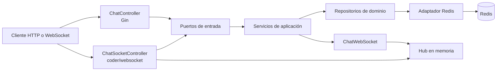
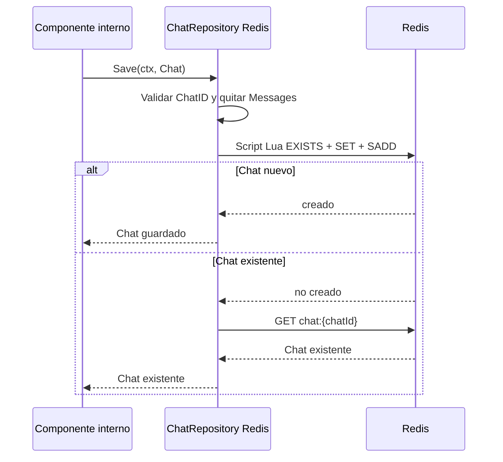
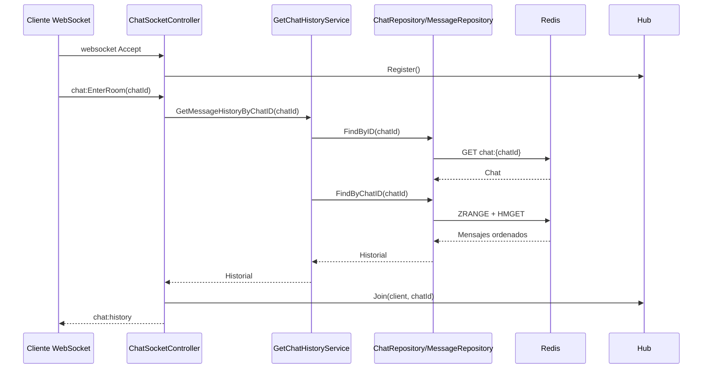
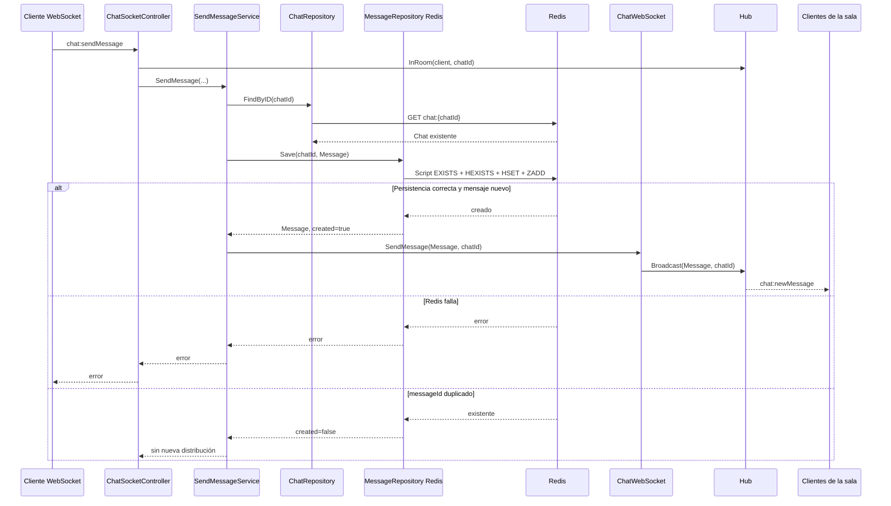

# Task-it-Chat-MS

Microservicio de chat desarrollado en Go para conservar conversaciones y
mensajes en Redis y distribuir mensajes en tiempo real mediante WebSockets.
Expone el historial por HTTP con Gin y mantiene las conexiones y salas activas
en memoria mediante un Hub.

Redis es el almacenamiento persistente de chats y mensajes. Los chats y sus
mensajes no expiran automáticamente: permanecen hasta que una operación de
borrado los elimina explícitamente. En esta versión no hay integración
implementada con RabbitMQ o Kafka; el archivo `.env.example` conserva
`RABBITMQ_URL` como configuración prevista, pero el bootstrap no la utiliza.

## Tecnologías utilizadas

| Tecnología | Uso |
| --- | --- |
| Go 1.22 | Lenguaje y runtime del servicio. |
| Gin | Registro y atención del endpoint HTTP de historial. |
| `github.com/coder/websocket` | Aceptación y lectura/escritura de conexiones WebSocket. |
| `github.com/redis/go-redis/v9` | Cliente Redis usado por los adaptadores de persistencia. |
| Redis | Persistencia de chats, índices y mensajes. |
| Mermaid | Diagramas de arquitectura y flujos en esta documentación. |

## Arquitectura hexagonal

El proyecto separa el dominio, los casos de uso y los adaptadores:

```text
cmd/chat/
└── main.go
    Punto de entrada; crea el bootstrap y ejecuta la aplicación.

internal/domain/model/
    Chat, Message y User.

internal/domain/repository/
    Contratos ChatRepository y MessageRepository, además de errores de dominio.

internal/application/port/inbound/
    Contratos que exponen los casos de uso a los adaptadores de entrada.

internal/application/port/outbound/
    Contratos que la aplicación necesita de adaptadores externos, como ChatWs.

internal/application/service/
    SendMessageService y GetMessageHistoryService.

internal/infra/inbound/
    Controladores HTTP Gin y controlador de entrada WebSocket.

internal/infra/outbound/
    Adaptadores Redis, Hub en memoria y distribución WebSocket.

internal/infrastructure/
    Inicialización técnica del cliente Redis y documentación de configuración.

internal/bootstrap/
    Ensamblaje de dependencias, router Gin, ciclo de vida HTTP y apagado ordenado.
```

La dirección de dependencias apunta hacia el dominio: los modelos y contratos
no conocen Redis, Gin ni WebSockets. Los servicios de aplicación dependen de
los puertos y repositorios; los adaptadores de entrada invocan esos servicios;
los adaptadores de salida implementan persistencia y distribución. `bootstrap`
construye las implementaciones concretas y las inyecta.



## Modelos de dominio

### `Chat`

`internal/domain/model.Chat` contiene:

| Campo | Tipo JSON | Descripción |
| --- | --- | --- |
| `ChatID` | `string` (`chatId`) | Identificador del chat. |
| `SellerID` | `string` (`sellerId`) | Identificador del vendedor; también se usa para el índice de participantes cuando es numérico. |
| `BuyerID` | `*int64` (`buyerId`) | Identificador opcional del comprador. |
| `Participants` | `[]User` (`participants`) | Participantes del modelo de dominio. `User` actualmente no tiene campos. |
| `Active` | `bool` (`active`) | Estado activo del chat. |
| `CreatedAt` | `time.Time` (`createdAt`) | Fecha de creación. |
| `Messages` | `[]Message` (`messages`) | Mensajes embebidos en el modelo; el adaptador Redis los separa en estructuras propias. |
| `TaskID` | `string` (`taskId`) | Tarea asociada al chat. |

El modelo ofrece `AddMessage` y `GetMessages`. Al guardar o actualizar en
Redis, `Messages` no se serializa dentro de la clave principal: el historial
se guarda en el repositorio de mensajes.

### `Message`

`internal/domain/model.Message` contiene:

| Campo | Tipo JSON | Descripción |
| --- | --- | --- |
| `MessageID` | `string` (`messageId`) | Identificador idempotente del mensaje. |
| `ChatID` | `string` (`chatId`) | Chat al que pertenece. |
| `SenderID` | `int64` (`senderId`) | Identidad del remitente recibida por el servicio. |
| `Content` | `string` (`content`) | Contenido del mensaje. |
| `Timestamp` | `time.Time` (`timestamp`) | Marca temporal usada también para ordenar el historial. |

### `User`

`User` es actualmente una estructura vacía. El chat mantiene el campo
`Participants`, pero no hay campos adicionales ni reglas de autorización
basadas en él implementadas en este repositorio.

## Casos de uso y contratos

Los puertos de entrada disponibles son:

- `SendMessageUseCase.SendMessage(ctx, chatID, messageID, content, senderID)`.
- `GetMessageHistoryUseCase.GetMessageHistory(ctx, taskID)`.
- `GetChatHistoryUseCase.GetMessageHistoryByChatID(ctx, chatID)`.

Los repositorios de dominio son:

- `ChatRepository`: `Save`, `FindByID`, `FindByParticipantID`,
  `FindByTaskID`, `Update`, `DeleteByID`, `DeleteByTaskID` y `Exists`.
- `MessageRepository`: `Save`, `FindByChatID` y `DeleteByChatID`.

`FindByParticipantID` mantiene el contrato actual de devolver un único chat,
aunque el índice Redis sea un conjunto y pueda contener más de uno.

## Flujo de creación de un chat

El repositorio Redis sí implementa `ChatRepository.Save`, pero actualmente no
existe un caso de uso ni un controlador HTTP/WebSocket que invoque esa
operación. Por tanto, este servicio no expone una API pública de creación de
chats; la creación debe ser integrada por otro componente o por una futura
entrada de aplicación.

Cuando un consumidor interno invoca `Save`:

1. Se valida que `ChatID` no esté vacío.
2. Se serializa el chat sin `Messages`.
3. Un script Lua crea la clave principal solo si no existe.
4. El mismo script agrega el ID a los índices de participantes y tarea.
5. Si el chat ya existe, se recupera el registro existente, evitando duplicar
   la creación.



No se utiliza RabbitMQ ni Kafka en este flujo.

## Flujo de conexión y recuperación del historial

La ruta WebSocket es `GET /ws/chat`. El controlador acepta la conexión,
registra un cliente en el Hub y comienza a leer eventos JSON. La conexión no
entra automáticamente a una sala.

Para `chat:EnterRoom`:

1. Se recorta y valida `chatId`; vacío produce un error de protocolo.
2. `GetMessageHistoryByChatID` verifica que el chat exista mediante
   `FindByID`.
3. El repositorio recupera el historial desde Redis.
4. Solo después de recuperar correctamente el historial, el Hub registra el
   cliente en la sala.
5. El cliente recibe `chat:history`.
6. La conexión permanece abierta para leer y recibir nuevos eventos.

No existe una autorización de participantes implementada. El único dato de
identidad disponible es el header `X-User-ID`, que se valida como entero
positivo y se coloca en el contexto; no es un mecanismo de autenticación
independiente.



Si el chat no existe o Redis falla, el cliente recibe un evento `error` y no
se une a la sala.

## Flujo de envío de mensajes

El evento de entrada es `chat:sendMessage`. El controlador exige que:

1. El cliente ya esté en la sala indicada.
2. Exista un `X-User-ID` válido en el contexto.
3. El caso de uso valide `chatId`, `messageId` y contenido.

`SendMessageService` verifica el chat con `FindByID`, crea un `Message` con
timestamp UTC, lo persiste mediante `MessageRepository.Save` y solo si la
operación crea el mensaje invoca `ChatWs.SendMessage`. El Hub entonces
distribuye `chat:newMessage` a los miembros conectados de esa sala.

El contenido vacío es inválido y el máximo es de 4096 runas. Un reintento con
el mismo `messageId` se reconoce en Redis y no vuelve a distribuirse. Si
Redis falla, el servicio devuelve el error y no se emite el mensaje.



Los clientes desconectados no reciben mensajes en tiempo real. Si vuelven a
conectarse y entran de nuevo a la sala, reciben desde Redis el historial
persistido. Si un cliente llena su buffer de salida de 32 mensajes, el Hub lo
desregistra como cliente lento.

## Redis y almacenamiento

El adaptador Redis usa `github.com/redis/go-redis/v9` y las siguientes claves
exactas:

| Clave | Tipo Redis | Uso |
| --- | --- | --- |
| `chat:{chatID}` | String JSON | Representación del chat sin `Messages`. |
| `chat:index:participant:{participantID}` | Set | IDs de chats asociados a un participante. |
| `chat:index:task:{taskID}` | Set | IDs de chats asociados a una tarea. |
| `chat:messages:{chatID}` | Hash | Mensaje JSON por `messageId`. |
| `chat:message-order:{chatID}` | Sorted set | IDs de mensajes con `Timestamp.UnixNano()` como score. |

### Operaciones

- `FindByID` usa `GET chat:{chatID}`.
- `FindByParticipantID` consulta el set de participante y devuelve el primer
  chat existente; limpia referencias obsoletas que encuentre.
- `FindByTaskID` consulta el set de tarea con el mismo comportamiento.
- `Save` usa un script Lua atómico para crear el chat y sus índices solo una
  vez.
- `Update` elimina el ID de los índices antiguos, guarda el chat y añade los
  nuevos índices dentro de una transacción Redis. Siempre conserva el
  `CreatedAt` almacenado y no modifica el historial de mensajes.
- `DeleteByID` elimina `chat:{chatID}`, `chat:messages:{chatID}` y
  `chat:message-order:{chatID}`, además de quitar el ID de todos los índices
  del chat, dentro de una transacción.
- `DeleteByTaskID` localiza el chat por tarea y delega en `DeleteByID`.
- `Exists` comprueba la existencia de la clave principal.

Los mensajes se guardan en un `HASH` y sus IDs en un `ZSET`; el historial se
lee en orden cronológico con `ZRANGE` y `HMGET`, sin cargar mensajes
individuales mediante múltiples consultas. El script de guardado comprueba
primero que exista el chat y usa `HEXISTS` para evitar duplicados por
`messageId`.

No se usa `EXPIRE`, `SETEX` ni otra expiración. Chats, índices y mensajes se
conservan indefinidamente hasta el borrado explícito.

## API HTTP

El bootstrap registra un único endpoint HTTP:

| Método | Ruta | Descripción | Parámetros | Respuesta | Errores |
| --- | --- | --- | --- | --- | --- |
| `GET` | `/api/v1/chats/messages` | Recupera el historial del chat asociado a una tarea. | Query requerido: `taskId`. | `200` con un array JSON de `Message`. | `400` si falta `taskId`; `404` si no existe el chat; `500` ante otros errores. |

Ejemplo:

```sh
curl 'http://localhost:8080/api/v1/chats/messages?taskId=task-123'
```

Respuesta exitosa:

```json
[
  {
    "messageId": "msg-456",
    "chatId": "chat-123",
    "senderId": 101,
    "content": "Hola",
    "timestamp": "2026-10-28T12:00:00Z"
  }
]
```

Errores del controlador:

```json
{"error":"taskId is required"}
```

o:

```json
{"error":"request failed"}
```

No hay endpoints HTTP registrados para crear, actualizar o borrar chats.
Tampoco existe un endpoint de health check o readiness; el proceso valida
`PING` contra Redis durante el arranque.

## Protocolo WebSocket

### Conexión

```text
ws://localhost:8080/ws/chat
```

El controlador acepta mensajes de texto JSON y limita cada mensaje recibido a
64 KiB. Opcionalmente puede enviarse `X-User-ID` en el handshake:

```sh
websocat -H='X-User-ID: 101' ws://localhost:8080/ws/chat
```

Ese header solo se transforma en un `senderId` positivo dentro del contexto;
no reemplaza un sistema de autenticación.

### Eventos de entrada

Entrar a una sala:

```json
{
  "type": "chat:EnterRoom",
  "chatId": "chat-123"
}
```

Enviar un mensaje:

```json
{
  "type": "chat:sendMessage",
  "chatId": "chat-123",
  "messageId": "msg-456",
  "content": "Hola"
}
```

El cliente no puede enviar `senderId`; se obtiene de `X-User-ID`. El
`messageId` es obligatorio para validar y deduplicar el mensaje.

### Eventos de salida

Historial entregado únicamente al cliente que entra:

```json
{
  "type": "chat:history",
  "data": [
    {
      "messageId": "msg-456",
      "chatId": "chat-123",
      "senderId": 101,
      "content": "Hola",
      "timestamp": "2026-10-28T12:00:00Z"
    }
  ]
}
```

Mensaje nuevo distribuido a los clientes conectados de la sala:

```json
{
  "type": "chat:newMessage",
  "data": {
    "messageId": "msg-789",
    "chatId": "chat-123",
    "senderId": 202,
    "content": "Respuesta",
    "timestamp": "2026-10-28T12:01:00Z"
  }
}
```

Error de protocolo o de aplicación:

```json
{
  "type": "error",
  "error": "messageId is required"
}
```

Los eventos desconocidos, JSON inválido, sala inexistente, contenido vacío,
falta de identidad o envío fuera de una sala se responden con `error`. Cuando
la conexión se cierra, el cliente se elimina del Hub y de todas sus salas.

## Configuración y ejecución local

### Requisitos

- Go 1.22.
- Redis accesible en la dirección configurada.
- Opcionalmente `websocat` para probar WebSockets.

No existe `docker-compose.yml` en el repositorio. El `Dockerfile` construye el
binario del servicio en una imagen `golang:1.22-alpine` y lo ejecuta en
Alpine, pero no inicia Redis.

### Variables de entorno

Copiar `.env.example` y ajustar los valores del entorno:

| Variable | Uso | Valor por defecto efectivo |
| --- | --- | --- |
| `APP_NAME` | Está documentada en `.env.example`, pero el código actual no la consume. | No aplica. |
| `HTTP_PORT` | Puerto HTTP y WebSocket. | `8080`. |
| `REDIS_ADDR` | Dirección `host:port` de Redis. | `localhost:6379`. |
| `REDIS_PASSWORD` | Contraseña de Redis. | Vacía. |
| `REDIS_DB` | Número de base Redis; si no es entero se usa `0`. | `0`. |
| `RABBITMQ_URL` | Reservada para una futura integración; no se consume. | `amqp://localhost:5672/`. |

Ejemplo:

```sh
cp .env.example .env
export HTTP_PORT=8080
export REDIS_ADDR=localhost:6379
export REDIS_PASSWORD=
export REDIS_DB=0
```

Iniciar Redis localmente, por ejemplo con una instalación existente:

```sh
redis-server
```

Arrancar el microservicio:

```sh
go run ./cmd/chat
```

También está disponible:

```sh
make run
```

El servicio hace `PING` a Redis antes de iniciar el servidor HTTP. Al recibir
`SIGINT` o `SIGTERM`, cierra el Hub, ejecuta el apagado ordenado del servidor
y cierra el cliente Redis.

Ejecutar pruebas:

```sh
go test ./...
go vet ./...
```

Las pruebas de Redis usan el servidor indicado por `REDIS_TEST_ADDR`, luego
`REDIS_ADDR` y finalmente `localhost:6379`; si no pueden conectarse, la prueba
de integración se omite. El Makefile define `make test` como alias de
`go test ./...`.

## Manejo de errores y consideraciones técnicas

- **Chat inexistente:** los repositorios devuelven `repository.ErrChatNotFound`
  envuelto en `ChatNotFoundError`. HTTP lo traduce a `404`; WebSocket envía un
  evento `error`.
- **Mensaje inválido:** se rechazan `chatId` o `messageId` vacíos, contenido
  vacío, contenido superior a 4096 runas y remitentes no positivos.
- **Redis no disponible:** el arranque falla si `PING` falla. Durante una
  operación, el error se propaga; un mensaje no se distribuye si no se
  persiste correctamente.
- **Mensajes duplicados:** el mismo `messageId` no se vuelve a guardar ni a
  distribuir. El reintento se considera exitoso sin una segunda emisión.
- **Desconexión:** el cliente se desregistra del Hub y deja de recibir
  emisiones. Los mensajes persistidos se recuperan al volver a entrar.
- **Clientes lentos:** si el buffer de salida de 32 mensajes se llena, el Hub
  desregistra el cliente.
- **Autenticación y autorización:** no existe middleware de autenticación ni
  autorización de participantes. `X-User-ID` es solo un mecanismo temporal de
  identidad para el flujo WebSocket.
- **Persistencia y distribución:** el Hub solo gestiona conexiones, salas y
  difusión; no accede directamente a Redis. El servicio de envío persiste
  antes de invocar el adaptador de distribución.

## Limitaciones y trabajo futuro

Estas capacidades no están implementadas actualmente:

- Caso de uso y endpoint para crear, actualizar o eliminar chats desde una API
  pública.
- Autenticación real y autorización de acceso por participantes.
- Integración con RabbitMQ o Kafka; el archivo `internal/infrastructure/rabbitmq`
  solo contiene documentación de infraestructura.
- Distribución del Hub entre varias instancias; las conexiones y salas son
  locales a un proceso.
- Endpoint HTTP de health/readiness.
- Pruebas end-to-end del flujo WebSocket y pruebas de integración Redis
  separadas del proceso de omisión cuando Redis no está disponible.

Estas limitaciones no afectan a las garantías existentes de persistencia sin
TTL, deduplicación por `messageId`, recuperación del historial y persistencia
antes de la distribución.
